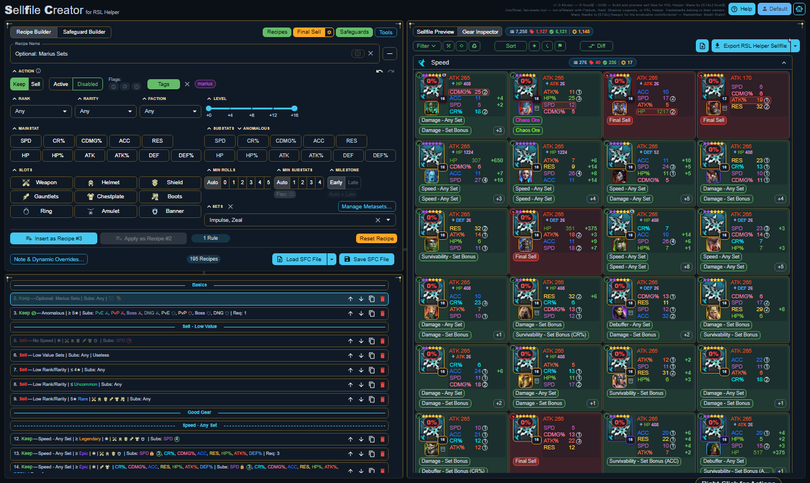
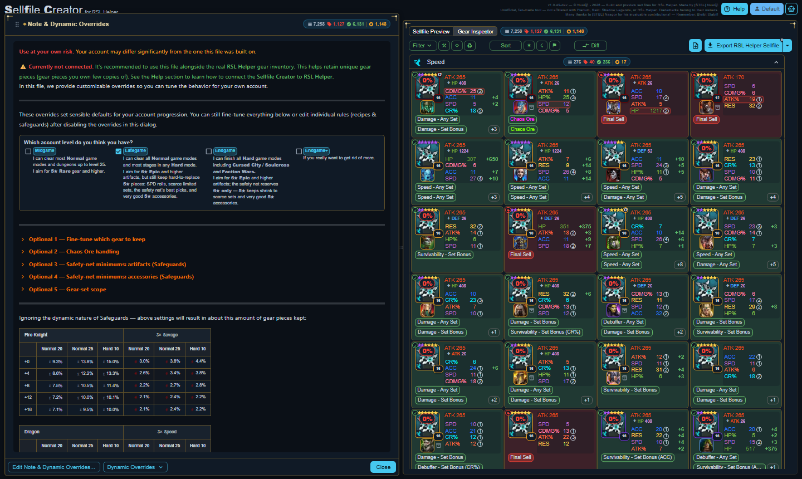
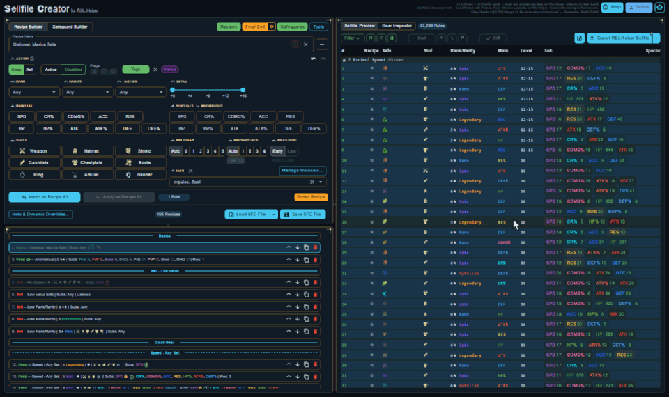
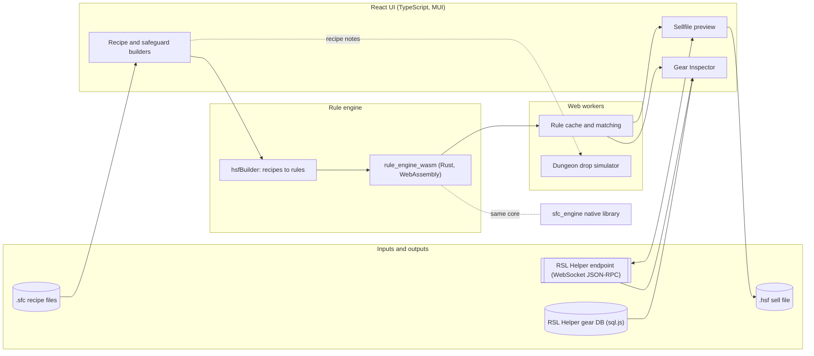

<p align="center">
  
</p>

**Sellfile Creator** builds sell files for RSL Helper, a companion tool for
*Raid: Shadow Legends*. You describe which gear to keep and which to sell as readable
**recipes** (slot, set, rank, rarity, main stat, substats with roll targets, faction, level
milestones). The app compiles them into an RSL Helper sell file, shows live which pieces of
your inventory each rule keeps or sells, and protects your best gear with safeguards.

It exists because hand-writing sell files means thousands of low-level rules: one wrong line
sells a good piece, a missing one floods the vault. Recipes keep the intent readable, and the
preview shows the result before anything is sold.

<picture>
  <source media="(prefers-color-scheme: light)" srcset="docs/readme/overview-light.png">
  
</picture>

> Independent, fan-made tool; not affiliated with Plarium, Raid: Shadow Legends or RSL Helper.

## Features

- **Recipe builder** — named keep/sell recipes with filters for slot, set, rank, rarity, main
  stat, substats (roll minimums, targets and caps), faction and level milestones.
- **Safeguards** — protect the best pieces per set, slot or stat profile, even where a sell
  recipe would match them.
- **Live preview** — the compiled rule list, and the **Gear Inspector**: your real inventory
  (from RSL Helper's database or its live endpoint), each piece judged keep or sell, with the
  rule that decided it.
- **Diff** — see exactly which pieces change verdict while you edit.
- **Export** — a ready-to-use RSL Helper sell file in one click, or pushed straight to RSL Helper.
- **Presets with notes** — a shipped late-game preset to start from. Each preset carries a note
  that explains it and asks a few questions (your account level, how to treat Chaos Ore, how
  strict the safeguards are); the answers tailor its rules to your account.
- **10 languages** — the whole app and its guide.
- **Decision library** — the same keep/sell engine as a native library for other programs
  ([integration kit](examples/decision-dll/README.md), MIT-licensed).

<picture>
  <source media="(prefers-color-scheme: light)" srcset="docs/readme/note-light.png">
  
</picture>

<p align="center">
  
</p>

## Getting started

**Use it:** download the [latest release](https://github.com/Nusi42/RslHelperSellfileCreator.Releases/releases/latest), unpack it and open `SellfileCreator.html` — or launch it
from RSL Helper. The [user guide](userDocs/README.md) explains every part of the app.

**Build it from source:**

| Requirement | Notes |
| ----------- | ----- |
| [Node.js](https://nodejs.org/) 22.15 or newer | `node:sqlite` and the built-in zstd are used by the tooling |
| [Rust](https://rustup.rs/) (stable) | `npm install` adds the `wasm32-unknown-unknown` target and `wasm-bindgen-cli` when missing |
| Windows | only for release packaging and the native decision library; everything else also runs on Linux/WSL |

```sh
npm install          # dependencies, Rust/WASM toolchain check, Playwright browsers, git hooks
npm run dev          # development server with live reload
npm run build        # single self-contained page: dist.app/index.html
npm run check        # private-data, license and commit checks, typecheck, lint, unit tests
npm run test:all     # everything, including the end-to-end suites
```

Builds from a plain clone use the app's own placeholder icons; builds with an asset pack embed
the game's icons instead.

## Architecture



- The app is one self-contained HTML page (Vite); rule compilation and matching run in Rust
  compiled to WebAssembly, off the main thread in web workers.
- `rule_engine_core` holds the shared Rust logic; `sfc_engine` exposes the same keep/sell
  decisions as a native library.
- Developer documentation: [docs/TECHNICAL.md](docs/TECHNICAL.md); the endpoint protocol:
  [userDocs/websocket-jsonrpc.md](userDocs/websocket-jsonrpc.md).

## Contributing

Issues and pull requests are welcome. Please read [CONTRIBUTING.md](CONTRIBUTING.md) first: it
explains the checks every change passes and the contributor license agreement.

## License

Sellfile Creator is free software under the **GNU Affero General Public License, version 3 or
later** ([`LICENSE`](LICENSE)). You may use, study, share and change it; if you distribute a
changed version, or let others use it over a network, you must make its source code available
under the same license. Other license terms are available from the maintainer. Contributions are
accepted under the [contributor license agreement](CONTRIBUTING.md#contributor-license-agreement).
The decision library's integration kit in `examples/decision-dll/` is MIT-licensed.
